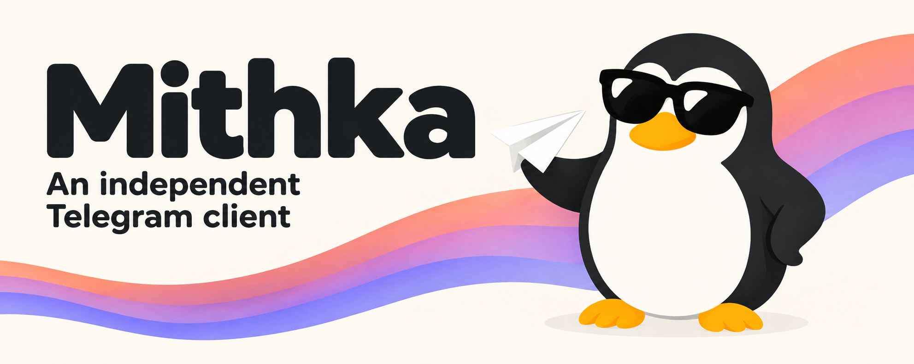

# MithkaX

English | [简体中文](README.zh-CN.md)

MithkaX is an unofficial fork of [Mithka](https://github.com/iebb/mithka),
the cross-platform Telegram client built with Flutter and
[TDLib](https://core.telegram.org/tdlib). It keeps Mithka's compact,
QQ-flavored interface and unlocks everything the upstream gates behind
payments and Telegram ToS acceptance:

- No paid tier — every "Pro" feature is available to everyone.
- No Telegram ToS gate — sign in and use the client as-is.
- Own package id (`x.empty.mithka`) — installs side-by-side with the
  official Mithka, upstream builds, or other forks.
- All branding switched to MithkaX.

## Download

Prebuilt, signed Android APKs are built by CI on every push to the default
branch. Grab the newest one from the
[Actions runs](https://github.com/TiaraBasori/MithkaX/actions/workflows/mithkax-android.yml)
(open a run, scroll to the `mithkax-apk` artifact). Two ABIs are shipped:
`arm64-v8a` for modern phones, `armeabi-v7a` for older devices.

iOS, Windows, macOS, and Linux are not built by this fork — use upstream
Mithka releases if you need those platforms.

## Relationship to upstream

MithkaX tracks [iebb/mithka](https://github.com/iebb/mithka) `master`.
The fork carries a small, self-contained rebrand patch on top; rebasing onto
a fresh upstream master is the intended update path. Everything here exists
because upstream Mithka deliberately locks these paths — if you want the
locked behavior back, use upstream.

## Disclaimer

MithkaX is an independent, unofficial project. It is not affiliated with,
endorsed by, or connected to Telegram. "Telegram" is a trademark of its
respective owner. This fork does not use, include, copy, or redistribute
proprietary QQ assets; "Tencent" and "QQ" trademarks belong to Tencent.

The client connects to Telegram through TDLib using its own API credentials.
Check Telegram's [Terms of Service](https://telegram.org/tos) and
[API Terms](https://core.telegram.org/api/terms) before using it.
