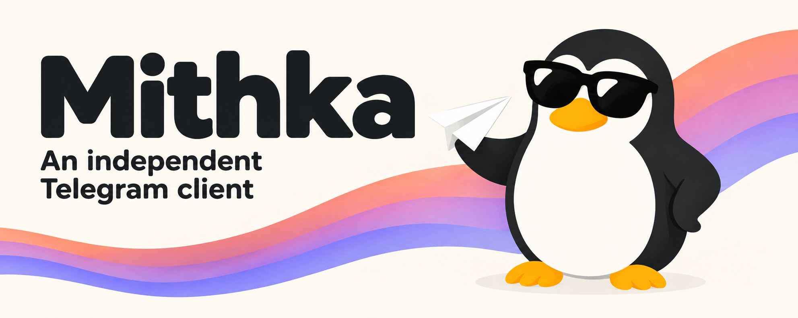

# MithkaX

[English](README.md) | 简体中文

Mithka X 是 [Mithka](https://github.com/iebb/mithka) 的非官方分支。Mithka
是基于 Flutter 与 [TDLib](https://core.telegram.org/tdlib) 的跨平台
Telegram 客户端。MithkaX 保留原版紧凑的 QQ 风格界面，同时解锁了上游
放在付费和 Telegram ToS 门后面的全部功能：

- 没有付费层 —— 所有 “Pro” 功能对所有人开放。
- 没有 Telegram ToS 门 —— 装好即用。
- 独立包名（`x.empty.mithka`）—— 可与官方 Mithka、上游构建或其他分支
  并排安装。
- 品牌全部换成 Mithka X。

## 下载

每次推送到主分支，CI 都会构建签好名的 Android APK。到
[Actions 页面](https://github.com/TiaraBasori/MithkaX/actions/workflows/mithkax-android.yml)
打开最新一次运行，拉取 `mithkax-apk` 附件即可。提供两个 ABI：
`arm64-v8a` 对应新手机，`armeabi-v7a` 对应老设备。

iOS、Windows、macOS、Linux 本分支不构建 —— 需要这些平台请用上游
Mithka 的发布。

## 与上游的关系

MithkaX 跟随 [iebb/mithka](https://github.com/iebb/mithka) 的 `master`。
分支上只带一层自包含的品牌改写补丁，更新方式就是 rebase 到新的上游
master。这里的一切都源于上游 Mithka 主动锁住了这些路径 —— 想要回被
锁住的行为，请用上游。

## 免责声明

Mithka X 是独立开发的非官方项目，与 Telegram 不存在任何隶属、认可或其他
关联。“Telegram”商标归其权利人所有。本分支不使用、不包含、不复制、不再分发
QQ 的专有素材；“Tencent”“QQ”商标归腾讯所有。

客户端通过 TDLib 使用自己的 API 凭证连接 Telegram。使用前请自行确认
Telegram 的[服务条款](https://telegram.org/tos)与
[API 条款](https://core.telegram.org/api/terms)。
